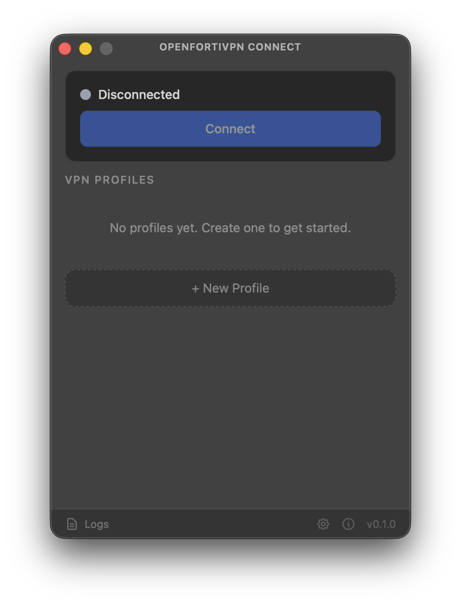

# OpenFortiVpn Connect

A lightweight, open-source macOS GUI client for [openfortivpn](https://github.com/adrienverge/openfortivpn).



## Why?

If you've ever used the official FortiClient on macOS, you know the pain: bloated, buggy, and unreliable. Constant crashes, broken updates, and features you never asked for getting in the way of the one thing you need — a VPN connection.

I got tired of depending on it. So I built **OpenFortiVpn Connect** — a minimal, native macOS GUI that wraps the excellent [openfortivpn](https://github.com/adrienverge/openfortivpn) CLI tool. No telemetry, no bloat, no surprises. Just a clean interface to manage your VPN profiles and connect.

The UI is inspired by [OpenVPN Connect](https://openvpn.net/client/) — simple, focused, and easy to use. Built with native macOS vibrancy for a modern frosted glass look that blends with your desktop.

## Features

- **Multiple VPN profiles** — save and switch between different VPN connections
- **SAML authentication** — full support for SSO/SAML login flows
- **Password auth** — credentials stored securely in the macOS Keychain
- **Certificate trust management** — pin server certificates by SHA256 digest
- **Native macOS look** — vibrancy blur, overlay title bar, system tray integration
- **System tray** — connect/disconnect and switch profiles without opening the app
- **Real-time logs** — monitor connection logs with optional debug mode
- **Lightweight** — small binary, minimal resource usage

## Installation

### Homebrew (recommended)

```bash
brew tap walcew/tap
brew install --cask openfortivpn-connect
```

### Manual

Download the `.dmg` for your architecture from [Releases](https://github.com/walcew/openfortivpn-connect/releases):

- **Apple Silicon (M1/M2/M3/M4):** `OpenFortiVpn.Connect_x.x.x_aarch64.dmg`
- **Intel:** `OpenFortiVpn.Connect_x.x.x_x64.dmg`

### openfortivpn is included

The app ships with its own build of [openfortivpn](https://github.com/adrienverge/openfortivpn) (statically linked with OpenSSL), so there is nothing else to install. On first run, the app installs its privileged Helper and the bundled openfortivpn with a single admin password prompt.

Upgrading from 0.1.x? Reinstall the Helper once, when the app asks for it.

## Prerequisites

- macOS 12 (Monterey) or later

## Building from Source

### Requirements

- [Rust](https://rustup.rs/) (1.77.2+)
- [Node.js](https://nodejs.org/) (18+)
- [Tauri CLI](https://tauri.app/)
- Xcode Command Line Tools (`xcode-select --install`)
- `brew install autoconf automake pkg-config` (to build the bundled openfortivpn)

`npm run build:openfortivpn` compiles openfortivpn and OpenSSL from source. It runs automatically on `tauri dev` and `tauri build`.

### Build

```bash
npm install
cargo tauri build
```

The built `.app` will be in `src-tauri/target/release/bundle/macos/`.

### Development

```bash
cargo tauri dev
```

## Tech Stack

- **Backend:** [Tauri v2](https://tauri.app/) + Rust
- **Frontend:** React 19 + TypeScript + Tailwind CSS v4
- **VPN engine:** [openfortivpn](https://github.com/adrienverge/openfortivpn) (CLI, bundled)
- **Security:** macOS Keychain for credential storage
- **DNS:** Native macOS `scutil` integration

## Credits

- [openfortivpn](https://github.com/adrienverge/openfortivpn) by Adrien Vergé — the open-source CLI tool that makes this project possible
- [OpenVPN Connect](https://openvpn.net/client/) — UI inspiration for the clean, profile-based interface
- [Tauri](https://tauri.app/) — the framework powering this native desktop app

## Disclaimer

This project is **not affiliated with, endorsed by, or associated with Fortinet, FortiClient, FortiGate, or FortiVPN** in any way. These are registered trademarks of Fortinet, Inc. This is an independent, open-source project that provides a graphical interface for the community-driven [openfortivpn](https://github.com/adrienverge/openfortivpn) tool.

## License

This project is licensed under the MIT License. See the [LICENSE](LICENSE) file for details.

### Bundled components

The app distributes the following components, which keep their own licenses. The license texts are included in the app bundle (`Contents/Resources/licenses`) and in [`src-tauri/licenses/`](src-tauri/licenses/).

- [openfortivpn](https://github.com/adrienverge/openfortivpn/tree/v1.24.1) 1.24.1 — GPL-3.0, with the OpenSSL linking exception. Source: the link above.
- [OpenSSL](https://github.com/openssl/openssl/tree/openssl-3.5.9) 3.5.9 — Apache-2.0, statically linked into openfortivpn.

## Author

**Wallacy Santos Ferreira** — [@walcew](https://github.com/walcew)
