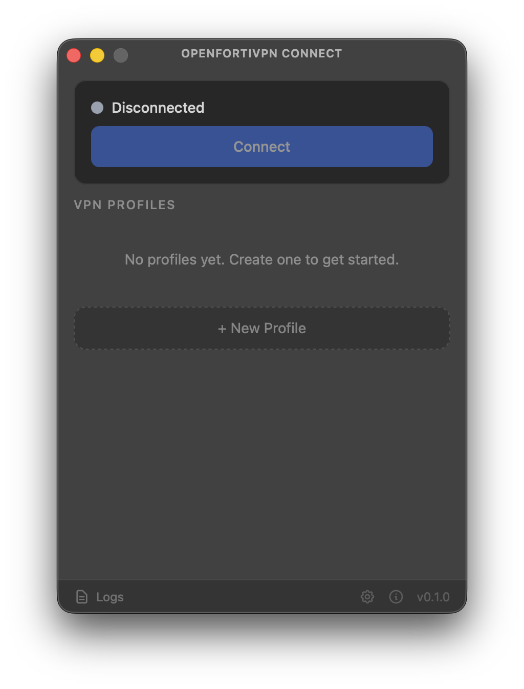

# OpenFortiVpn Connect

A lightweight, open-source macOS GUI client for FortiGate SSL-VPN.



## Why?

If you've ever used the official FortiClient on macOS, you know the pain: bloated, buggy, and unreliable. Constant crashes, broken updates, and features you never asked for getting in the way of the one thing you need — a VPN connection.

I got tired of depending on it. So I built **OpenFortiVpn Connect** — a minimal, native macOS client with its own Fortinet SSL VPN engine, written in Rust. No telemetry, no bloat, no surprises. Just a clean interface to manage your VPN profiles and connect.

The UI is inspired by [OpenVPN Connect](https://openvpn.net/client/) — simple, focused, and easy to use. Built with native macOS vibrancy for a modern frosted glass look that blends with your desktop.

## Features

- **Multiple VPN profiles** — save and switch between different VPN connections
- **SAML authentication** — full support for SSO/SAML login flows
- **Password auth** — credentials stored securely in the macOS Keychain
- **Certificate trust management** — pin server certificates by SHA256 digest
- **Native macOS look** — vibrancy blur, overlay title bar, system tray integration
- **System tray** — connect/disconnect and switch profiles without opening the app
- **Real-time logs** — monitor connection logs and bandwidth
- **Dead tunnel and expiry handling** — the network is restored as soon as the tunnel drops or the session expires, with a notification
- **Lightweight** — small binary, minimal resource usage

## Installation

### Homebrew (recommended)

```bash
brew tap walcew/tap
brew install --cask openfortivpn-connect
```

### Manual

Download the `.dmg` for your architecture from [Releases](https://github.com/walcew/openfortivpn-connect/releases):

- **Apple Silicon (M1/M2/M3/M4):** `OpenFortiVpn.Connect_x.x.x_aarch64.dmg`
- **Intel:** `OpenFortiVpn.Connect_x.x.x_x64.dmg`

### First run and upgrades

On first run, the app installs its privileged Helper with a single admin password prompt. The Helper owns the VPN session: it logs in to the gateway, opens the tunnel and applies routes and DNS. There is nothing else to install.

Upgrading from 0.3.x or earlier? Reinstall the Helper once, when the app asks for it: the installer also removes the previous Helper. Extra openfortivpn options saved in a profile (`extra_args`) no longer apply; the app logs a warning when you connect such a profile.

## Prerequisites

- macOS 12 (Monterey) or later

## Building from Source

### Requirements

- [Rust](https://rustup.rs/) (1.77.2+; CI uses 1.99)
- [Node.js](https://nodejs.org/) (18+)
- [Tauri CLI](https://tauri.app/)
- Xcode Command Line Tools (`xcode-select --install`)

### Build

```bash
npm install
cargo tauri build
```

The built `.app` will be in `src-tauri/target/release/bundle/macos/`.

### Development

```bash
cargo tauri dev
```

## Tech Stack

- **Backend:** [Tauri v2](https://tauri.app/) + Rust
- **Frontend:** React 19 + TypeScript + Tailwind CSS v4
- **VPN engine:** Fortinet SSL VPN client in Rust (rustls, utun, PPP), running in the privileged Helper
- **Security:** macOS Keychain for credential storage
- **DNS:** Native macOS `scutil` integration

## Credits

- [OpenVPN Connect](https://openvpn.net/client/) — UI inspiration for the clean, profile-based interface
- [Tauri](https://tauri.app/) — the framework powering this native desktop app

## Disclaimer

This project is **not affiliated with, endorsed by, or associated with Fortinet, FortiClient, FortiGate, or FortiVPN** in any way. These are registered trademarks of Fortinet, Inc. This is an independent, open-source project.

## License

This project is licensed under the MIT License. See the [LICENSE](LICENSE) file for details.

## Author

**Wallacy Santos Ferreira** — [@walcew](https://github.com/walcew)
